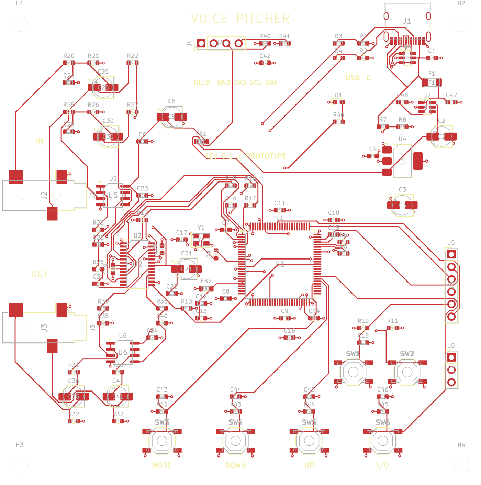

# Voice Pitcher — standalone audio DSP prototype

**98 × 98 mm、表面のみの部品実装、SSD1306表示器と4つの操作ボタンを備えた音声エフェクターの設計・ファームウェアです。** STM32H743とPCM3060を使い、ステレオライン入出力とUSB-Cオーディオを切り替えます。

現在は **Rev 0.1の未実機検証プロトタイプ** です。回路図ERC・基板DRC・未接続はすべて0件、回路図とPCBの端子接続も照合済みです。実機の起動、USB互換性、音質、遅延、消費電流、温度は未測定です。添付データは試作レビュー用で、量産承認済みではありません。

## ダウンロード

- [全データ ZIP](downloads/voice_pitcher_rev0.1_prototype.zip?raw=true) — 回路図、PCB、製造データ、ファームウェア、説明書、検証記録
- [ガーバー・ドリル ZIP](downloads/voice_pitcher_gerbers.zip?raw=true)
- [JLCPCB用 BOM](downloads/jlc_bom.csv?raw=true) / [CPL](downloads/jlc_cpl.csv?raw=true) / [調達状況付き全BOM](downloads/bom_master.csv?raw=true)
- [日本語説明書 PDF](downloads/voice_pitcher_manual_ja.pdf?raw=true) / [回路図 PDF](downloads/schematic.pdf?raw=true) / [表面実装図 PDF](downloads/assembly-top.pdf?raw=true)
- [ファームウェア BIN](downloads/firmware/voice_pitcher.bin?raw=true) / [HEX](downloads/firmware/voice_pitcher.hex?raw=true) / [ELF](downloads/firmware/voice_pitcher.elf?raw=true)
- [検証結果](downloads/reports/hardware.json) / [DSP周波数テスト](downloads/reports/dsp-spectral.json) / [SHA-256](downloads/SHA256SUMS.txt)

CSVはページ右上のDownload raw file、ZIPは上記リンクから保存できます。BOMの空欄LCSC番号は未確定部品です。注文前に [製造手順](docs/manufacturing.md) の照合が必要です。



## 設計内容

|項目|Rev 0.1の内容|
|---|---|
|基板|98 × 98 mm、4層、部品は全てTOP。片面実装であり、片面銅箔基板ではありません|
|処理|STM32H743VIT6、400 MHz、32 bit float DSP、24 bit / 48 kHzステレオ|
|変換|PCM3060PWR、独立したADC/DAC、アナログ5 V・デジタル3.3 V|
|アナログ端子|入力・出力各1個の3.5 mm TRSステレオライン。6.35 mmは外付け変換アダプタ|
|USB-C|USB 2.0 Full Speed、UAC2のデバイス。PC・スマホ側がホスト|
|ルーティング|LINE→LINE、LINE→USB、USB→LINE、USB→USB|
|操作|SSD1306 128×64 I²C、MODE / DOWN / UP / I/O、別途RESET / BOOT|
|エフェクト|DRY、±12半音ピッチ変更、単音ピッチ補正、500 msディレイ、5 Hzトレモロ|
|スタンドアローン|PC不要のLINE→LINE動作。5 Vで1.5 A以上を広告するType-C電源を想定|
|調達|抵抗と100 nFを中心にJLCPCB Basicへ寄せた構成。全品Basicではありません|

**ピッチ変更を「音質ロスゼロ・遅延ゼロ」で行うことはできません。** 音程推定には観測時間が必要で、ADC/DAC・バッファにも遅延があります。本設計は専用基板上のMCUでリアルタイム処理します。無加工デジタルDRYは24 bit整数の往復一致をテスト済みですが、アナログ往復やピッチ処理の無損失を意味しません。

DRYのアナログ往復は計算上約2.1 msを起点とする設計です。ピッチ処理は可変遅延約1.3–65.3 ms、音程検出は約42.7 msの窓に分割演算と追従時間が加わります。USB経路はさらにホストのバッファに依存します。いずれも実測保証値ではありません。

## 使い方と設計資料

1. [ハードウェア仕様・ピン配置](docs/hardware.md)
2. [ファームウェア・操作・ビルド](docs/firmware.md)
3. [JLCPCB製造・部品調達](docs/manufacturing.md)
4. [検証済み範囲と実機チェック](docs/validation.md)
5. [データシートと依存ライブラリ](docs/sources.md)

通常のマイク、パッシブギター、ヘッドホンを直接つなぐための回路ではありません。マイクには外部プリアンプ、楽器には適切なバッファ、ヘッドホンには外部アンプを使用してください。USBホスト機能はないため、別のUSBオーディオインターフェースを本機へ直接接続する構成には対応しません。

KiCad 9で [hardware/voice_pitcher.kicad_pro](hardware/voice_pitcher.kicad_pro) を開けます。配線済みPCBは `voice_pitcher.kicad_pcb` です。`placement.kicad_pcb` は再配置・再配線用の中間ファイルです。

```sh
bash tools/bootstrap.sh
make test
make firmware
make hardware-check
make exports
python3 tools/package_release.py
```

必要なツールとインストール方法は [ビルド手順](docs/firmware.md) を参照してください。オリジナルコード・設計はMIT、同梱KiCadライブラリと外部依存物にはそれぞれのライセンスが適用されます。
